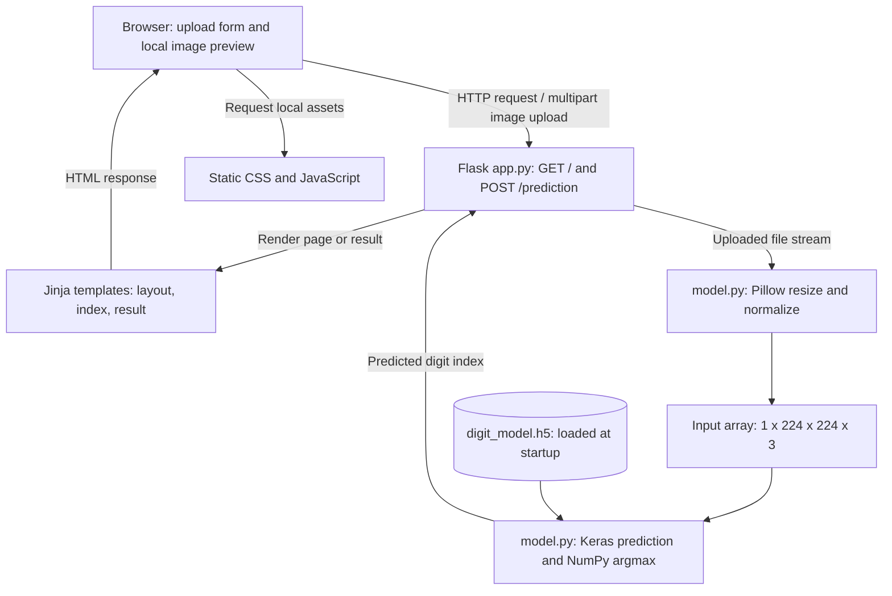

# Step 2 - Legacy application exploration

Repository: https://github.com/Yaksh-P/Flask_Image_Recognition

This review describes the original application before quality improvements.
No application code was changed during this step.

## Main components

| File or folder | Purpose |
| --- | --- |
| `app.py` | Creates the Flask application, defines the home and prediction routes, and renders HTML responses. |
| `model.py` | Loads the trained Keras model, preprocesses uploaded images, and selects the predicted class. |
| `digit_model.h5` | Saved model weights and architecture loaded for inference; training is not performed by the web application. |
| `templates/layout.html` | Shared HTML layout; links Bootstrap, jQuery, local CSS, and upload JavaScript. |
| `templates/index.html` | Home page containing a multipart form with the upload field named `file`. |
| `templates/result.html` | Shows a prediction or the processing error message. |
| `static/css/custom.css` | Gradient background, upload controls, and preview styling. |
| `static/js/image_upload.js` | Uses FileReader to preview the selected image in the browser and display its filename. |
| `test_images/` | Sample hand-sign photographs organized by digit. |
| `conftest.py` and `test_*.py` | Existing pytest fixtures and tests inherited from the starter; these are not newly authored assignment work. |
| `requirements.txt` | Original pinned runtime packages and pytest. |
| `.github/workflows/ci.yml` | Inherited CI workflow; currently selects Python 3.9 and runs only `test_model.py`. It does not yet satisfy the assignment's Pylint and complete-test requirements. |

## Application configuration

`app = Flask(__name__)` in `app.py` creates the application. Flask discovers
`templates/` and `static/` using its default folder conventions. The `GET /`
route calls `main()` and renders `index.html`. The `POST /prediction` route
calls `predict_image_file()`.

Running `python app.py` uses the startup block with port 9000 and debug enabled.
Our verified command, `python -m flask --app app run --port 9000`, uses the Flask
CLI and runs with debug off. Only one server should run on that port.

## Model loading and image preprocessing

At import time, `model.py` calls `load_model("digit_model.h5")`. Importing
`app.py` therefore also loads TensorFlow/Keras and the saved model before the
server is ready. The relative model path depends on the working directory.

`preprocess_img()` opens the uploaded file stream with Pillow, resizes the
image to 224 by 224 pixels, converts it to an array, divides pixel values by
255.0, and reshapes it to `(1, 224, 224, 3)`. The first dimension represents
one input image; the final dimension represents three color channels.
The current implementation assumes three channels and does not explicitly
convert grayscale or transparent images to RGB.

`predict_result()` passes that array to `model.predict()`. It applies NumPy
`argmax` to the first output row and returns the index with the highest model
score. It returns a class index rather than a confidence score.

## Request flow

1. The browser requests `/` and Flask renders the upload page.
2. The user selects a local hand-sign image. JavaScript previews it locally;
   selecting a file alone does not run prediction.
3. Submit sends a multipart HTTP POST to `/prediction`, with the image in `file`.
4. Flask reads `request.files['file'].stream` and calls `preprocess_img()`.
5. The prepared array goes to `predict_result()` and the already-loaded model.
6. Flask converts the predicted index to text and renders `result.html`.
7. The browser displays the returned HTML. The upload is read from its stream;
   the application code does not explicitly save it to a permanent upload folder.

On an exception, the route renders `result.html` with `File cannot be processed.`
The current bare `except` hides the underlying cause and returns the default
HTTP 200 even for bad input. These are candidates for later improvements.

## Logical architecture diagram

The browser and Flask server run on the same computer in the verified local
deployment. Flask listens on `127.0.0.1:9000`. Preprocessing and model inference
run in the Python server process on the CPU. The application has no database
or separate prediction service. The HTML layout also requests Bootstrap and
jQuery from external CDNs, so those resources need network access unless cached.

## Observations for later steps

- Add meaningful docstrings and replace the bare exception handler.
- Validate missing or invalid uploads and explicitly handle RGB conversion.
- Resolve the model path relative to its module rather than the working directory.
- Review inherited tests: some purported valid-image tests send arbitrary text
  bytes rather than encoded images, so their names do not prove valid coverage.
- Update inherited CI to Python 3.10, install compatibility constraints, run
  Pylint, and run the complete intended pytest suite.

These are review findings, not completed fixes. Steps 3-5 will implement and
verify the relevant changes with a separate development history.
